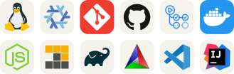

# Hola, soy Arturo

Programo por hobby desde que hacía bots de Discord 
Todavía me falta mucho por aprender, pero ahí voy

 

<a href="https://discord.com/users/624712119098802198">
  <picture>
    <source media="(prefers-color-scheme: dark)" srcset="https://lanyard.cnrad.dev/api/624712119098802198?theme=dark&showDisplayName=true&borderRadius=12px&idleMessage=Fracasa%20otra%20vez.%20Fracasa%20mejor">
    
  </picture>
</a>

  

Si quieres charlar, escríbeme

  

### Herramientas

<picture>
  <source media="(prefers-color-scheme: dark)" srcset="assets/herramientas-dark.svg">
  
</picture>

### Lenguajes

<picture>
  <source media="(prefers-color-scheme: dark)" srcset="https://raw.githubusercontent.com/ArturoAtomplay/ArturoAtomplay/output/lenguajes-dark.svg">
  
</picture>

